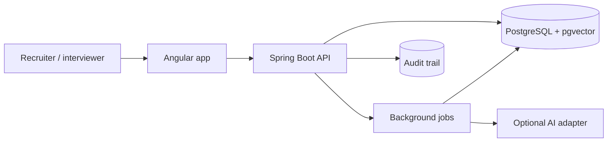

# TalentForge

**Recruitment operations with evidence-backed AI assistance.** TalentForge keeps job requisitions, applications, interviews and scorecards in one consistent workflow. AI drafts summaries grounded in reviewer notes, but people make every hiring decision.

> **Status:** early development, following a 7-week roadmap (see below). The project uses only synthetic data and fictional applicants.

## The problem

Hiring teams lose context across applications, interview feedback and scheduling tools. Recruiters need:

- a consistent process from job opening to decision
- structured, comparable interview feedback
- summaries they can trust, with links back to the source notes

TalentForge provides that workflow and keeps AI in an assisting role. It never advances, rejects or ranks a candidate on its own.

## Who it's for

- **Recruiters:** manage requisitions, pipelines and candidate communication
- **Hiring managers:** approve openings and decide on next stages
- **Interviewers:** schedule interviews and submit structured scorecards
- **Applicants (demo):** apply and track their application
- **Administrators:** manage access, retention and audit history

## Demo workflow

1. Publish a synthetic job opening
2. Submit a fictional applicant profile
3. Move the application through hiring stages
4. Schedule a simulated interview
5. Record a structured scorecard
6. Generate a summary that links to its sources
7. A person decides the next stage
8. Export the audit history

## Planned features

- Job requisitions with approvals
- Applicant portal (fictional data)
- Resume parsing with explicit human review
- Configurable hiring stages
- Interview scheduling with conflict checks, and scorecards
- Candidate communication templates
- Structured interview rubrics
- AI summaries grounded in reviewer notes
- Decision audit trail and access controls
- Recruiting funnel and time-to-stage analytics

## Tech stack

| Layer | Technology |
|---|---|
| Frontend | Angular, TypeScript |
| Backend | Java, Spring Boot, Spring Security |
| AI integration | Spring AI |
| Database | PostgreSQL with pgvector |
| Cache | Redis |
| Local environment | Docker Compose |
| CI | GitHub Actions |

## Architecture

TalentForge starts as a modular monolith for transactional writes. Slow work such as document parsing and AI summaries runs in background jobs. PostgreSQL is the single source of truth.



### Planned repository layout

```text
talentforge/
├── apps/web/              # Angular frontend
├── services/api/          # Spring Boot domain API
├── services/worker/       # background jobs
├── packages/contracts/    # OpenAPI contracts
├── packages/fixtures/     # synthetic hiring data
├── infra/compose/         # local services
├── tests/                 # integration and end-to-end tests
└── docs/                  # architecture decisions and progress notes
```

## Design rules

- AI output is a draft. It must cite reviewer notes and never makes or applies a hiring decision.
- Every stage change is made by an authorized person and recorded in the audit trail.
- Permissions are enforced on the server, not just in the UI.
- Applicant data has explicit privacy and retention rules.
- Retries are safe through idempotency keys and unique constraints.

## Roadmap

| Week | Focus | Status |
|---|---|---|
| Week 1 | **Foundation** — Scaffold Angular and Spring Boot workspace with Compose stack, add synthetic hiring data generator with tests | ✅ Done |
| Week 2 | **Auth & requisitions** — Add Spring Security login with users and roles, enforce recruiter permissions with tests, add login and app shell, add job requisition approval workflow, add requisition screens | ✅ Done |
| Week 3 | **Applicant portal** — Add public job listing and application form, add resume upload with type and size validation | Planned |
| Week 4 | **Pipeline & interviews** — Add stage state machine, add pipeline board, add interview scheduling, detect scheduling conflicts | Planned |
| Week 5 | **Scorecards & metrics** — Add structured scorecards, add feedback form, add funnel analytics endpoint, add recruiting metrics dashboard | Planned |
| Week 6 | **AI summaries & privacy** — Add candidate summary drafts with mock model and citations, require reviewer approval for summaries, add retention and deletion jobs | Planned |
| Week 7 | **Release** — Add accessibility checks, add concurrency and security tests, add build and test workflow, add setup guide, demo script and runbooks | Planned |

## Documentation

- [Architecture decisions](docs/adr/)
- [Week 1 acceptance cases](docs/acceptance/week-01-workspace-and-hiring-fixtures.md)
- [Progress notes](docs/progress/week-01.md)

## Getting started

Setup instructions will be added once the first services are in place.
